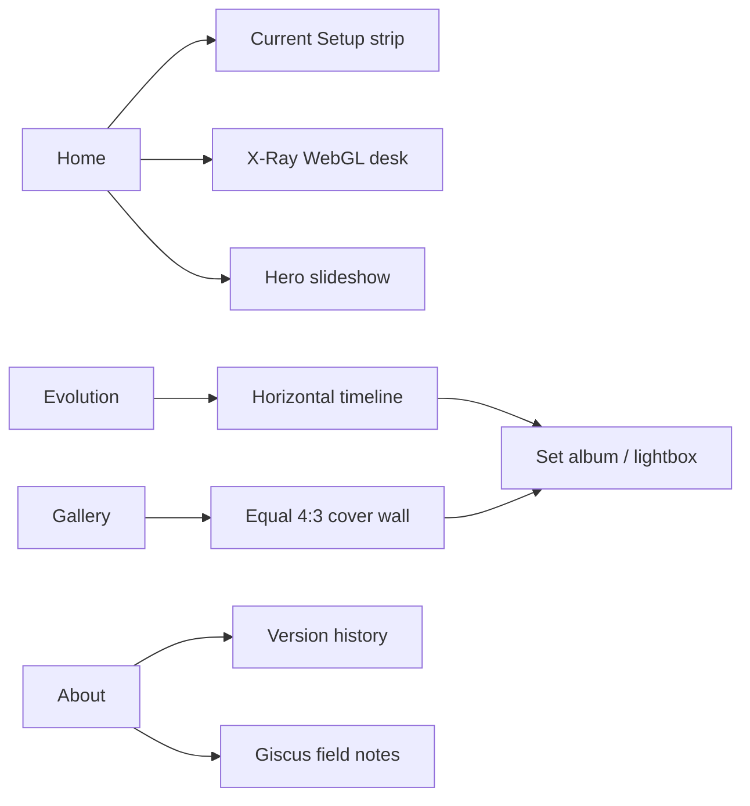

<p align="center">
  
</p>

<h1 align="center">THE DESK PROJECT</h1>

<p align="center">
  <strong>A digital archive of my workspace evolution.</strong><br/>
  Photographs · short loops · timeline · X-Ray desk<br/>
  by <a href="https://krwg.github.io/krwg/">krwg</a>
</p>

<p align="center">
  <a href="https://krwg.github.io/deskproject/"></a>
  
  
</p>

---

## What this is

Not a template. Not a starter kit. This repository hosts **my** desk — how it looked, how it changed, and how it looks now.

The site reads like a small technical museum: Swiss type, monochrome covers that open into color, Light / Dark / System theme. Sets are chronological folders. Oldest on the left. Newest on the right.

**Live site → [krwg.github.io/deskproject](https://krwg.github.io/deskproject/)**

---

## Map of the archive



| Section | What you get |
|--------|----------------|
| **Home** | Full-bleed hero with rotating set covers, Current Setup drag strip, project note, interactive **X-Ray** wireframe |
| **Evolution** | Museum timeline — cards above / below the axis, **OPEN SET** opens that album |
| **Gallery** | Equal **4:3** cover wall (responsive columns); click a set for clarifying frames and short video loops |
| **About** | Statement, structure, version history, Giscus notes |

There is no separate Hardware page. Old `/hardware` URLs fall through to Home.

---

## The desk in X-Ray

Home section **03** is a live WebGL plate. Dark theme: white edges on black. Light theme: black edges on white.

Built to real proportions — desk, pedestal, case with coolers, monitor + soundbar, keyboard and mouse with a clear gap toward the sitter, mic arm, chair. Drag to orbit. Scroll to zoom (page scroll stays locked over the plate). Three.js loads only when that section mounts.

---

## How the archive is ordered

```
01  →  oldest
…
NN  →  newest
```

- **Gallery / Evolution** — every set that has media, chronological
- **Current Setup (Home)** — the newest sets as a horizontal strip
- **Hero background** — slideshow of selected set covers (crossfade + slow Ken Burns)

Opening a cover always goes: set grid → single frame. Covers stay mono on the wall; the lightbox is a darkroom (readable in both themes).

---

## Media & performance notes

Pipeline (`npm run images`) builds WebP + thumbnails. The UI uses:

- `loading="lazy"` / `decoding="async"` on archive images
- `srcSet` thumb + full where available
- `content-visibility` on media frames
- deferred Three.js chunk for X-Ray

That keeps the archive usable as set count grows; it is not a substitute for measuring LCP/CLS on a real device after large additions.

---

## Version 1.0

Public foundation of the project:

- Vite + React SPA on GitHub Pages
- Folder sets with automatic discovery after the image pipeline
- WebP / thumbs, short muted video loops
- Home hero slideshow + Current Setup + X-Ray
- Light / Dark / System theme
- Evolution timeline with OPEN SET
- Gallery wall + SetLightbox
- About + version history + Giscus
- Mobile layout that leaves the desktop composition alone

---

## Stack

<p>
  
  
  
  
  
  
</p>

Deployed from `main` → `gh-pages` via GitHub Actions.

---

## Author

**krwg** — [krwg.github.io/krwg](https://krwg.github.io/krwg/)

This repo exists to show the site and the desk. Photos and name stay with the author.

---

## License

Apache License 2.0 — see [LICENSE](LICENSE).
