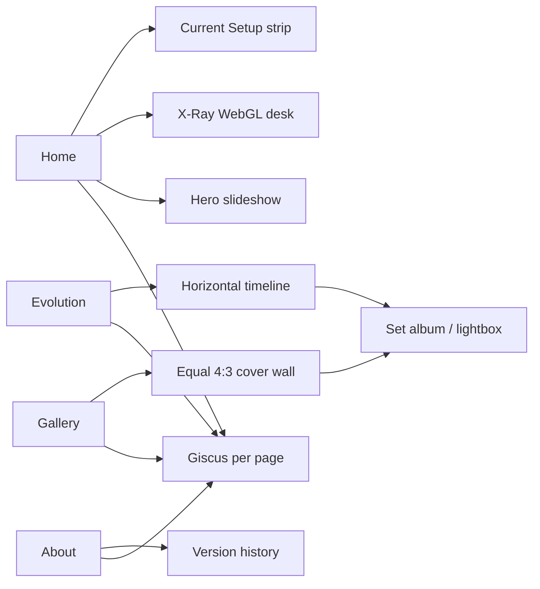

<p align="center">
  
</p>

<h1 align="center">THE DESK PROJECT</h1>

<p align="center">
  <a href="README.md">English</a>
</p>

<p align="center">
  <strong>Цифровой архив эволюции моего рабочего места.</strong><br/>
  Фото · короткие лупы · таймлайн · X-Ray стол<br/>
  by <a href="https://krwg.github.io/krwg/">krwg</a>
</p>

<p align="center">
  <a href="https://krwg.github.io/deskproject/"></a>
  
  
</p>

---

## Что это

Не шаблон и не starter kit. В репозитории — **мой** стол: как выглядел, как менялся и как выглядит сейчас.

Сайт собран как небольшой технический музей: швейцарская типографика, монохромные обложки, которые открываются в цвет, тема Light / Dark / System. Сеты — хронологические папки. Слева старые, справа новые.

**Сайт → [krwg.github.io/deskproject](https://krwg.github.io/deskproject/)**

Добавление контента: [`CONTENT.md`](CONTENT.md) (EN) и кратко [`public/images/sets/README.md`](public/images/sets/README.md).

---

## Карта архива



| Раздел | Что внутри |
|--------|------------|
| **Home** | Полноэкранный hero с обложками, полоса Current Setup, заметка о проекте, интерактивный **X-Ray** |
| **Evolution** | Таймлайн — карточки сверху/снизу оси, **OPEN SET** открывает альбом |
| **Gallery** | Сетка обложек **4:3**; клик по сету — кадры и короткие видеолупы |
| **About** | Statement, структура, история версий |
| **Comments** | Giscus на каждой странице — отдельный Discussion на роут (`page-home`, `page-gallery`, …) |

Отдельной страницы Hardware нет. Старые URL `/hardware` ведут на Home.

---

## Стол в X-Ray

Секция **03** на Home — живая WebGL-пластина. Тёмная тема: белые рёбра на чёрном. Светлая: чёрные на белом.

Пропорции реальные — стол, тумба, корпус с кулерами, монитор + саундбар, клавиатура и мышь с зазором к сидящему, рука микрофона, кресло. Drag — орбита. Scroll — зум (скролл страницы над пластиной заблокирован). Three.js подгружается только при монтировании секции.

---

## Порядок архива

```
01  →  самый старый
…
NN  →  самый новый
```

- **Gallery / Evolution** — все сеты с медиа, по хронологии
- **Current Setup (Home)** — самые новые сеты горизонтальной полосой
- **Hero** — слайдшоу выбранных обложек (crossfade + лёгкий Ken Burns)

Обложка всегда ведёт: сетка сета → один кадр. На стене обложки монохромные; lightbox — «тёмная комната» (читается в обеих темах).

Шаринговые URL сетов: `/gallery/44` (закрытие → `/gallery`).

---

## Медиа и производительность

Пайплайн (`npm run images`) собирает WebP и thumbs. Для видео нужен **ffmpeg** в PATH: пишутся короткие `*-loop5.mp4` (сайт не должен отдавать сырые `.MOV` с телефона). В UI:

- `loading="lazy"` / `decoding="async"`
- `srcSet` thumb + full где есть
- `content-visibility` на кадрах
- отложенный чанк Three.js для X-Ray

Это помогает при росте числа сетов, но не заменяет замер LCP/CLS на реальном устройстве после крупных добавлений.

`sets.manifest.json` грузится отдельным ассетом (не вшит в основной JS), чтобы critical bundle не раздувался вместе с архивом.

Перед коммитом контента:

```bash
npm run images
npm run check:manifest
```

---

## Версия 1.1.0

На базе публичного архива 1.0:

- Vite + React SPA на GitHub Pages
- Папочные сеты с автоподхватом после image pipeline
- WebP / thumbs, короткие muted video loops
- Home hero + Current Setup + X-Ray
- Light / Dark / System
- Язык интерфейса EN / RU (переключатель в шапке)
- Evolution с OPEN SET
- Gallery + SetLightbox
- About + version history
- Giscus на каждой странице (свой тред на роут)
- Мобильная вёрстка без ломки десктопной композиции
- Maintenance: единая версия, EN gallery sort, docs/CI/UX follow-ups
- Deep-link `/gallery/:setId`, отдельный fetch манифеста, a11y lightbox

---

## Стек

<p>
  
  
  
  
  
  
</p>

Деплой: `main` → `gh-pages` через GitHub Actions.

---

## Автор

**krwg** — [krwg.github.io/krwg](https://krwg.github.io/krwg/)

Репозиторий показывает сайт и стол. Фото и имя остаются за автором.

---

## Лицензия

Apache License 2.0 — см. [LICENSE](LICENSE).
